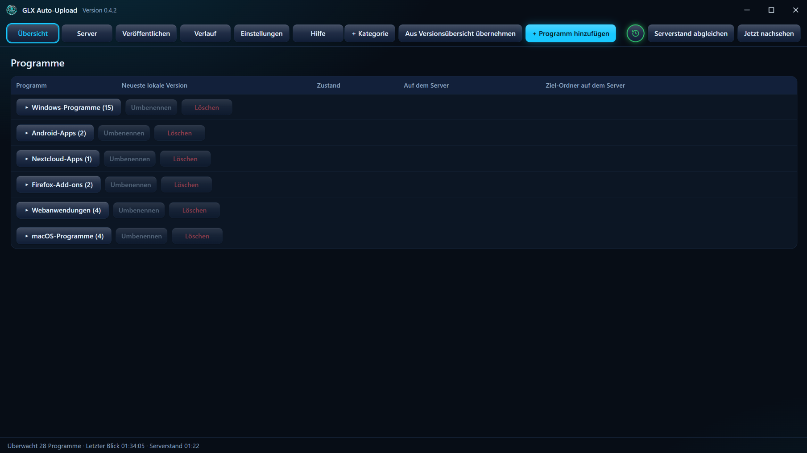
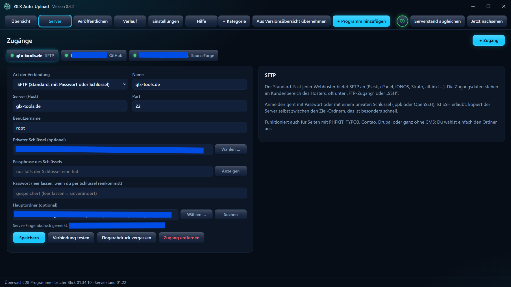
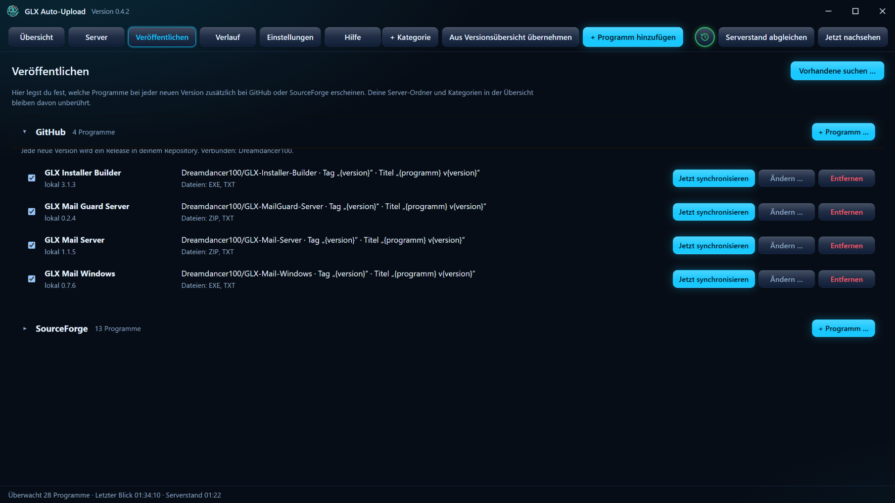
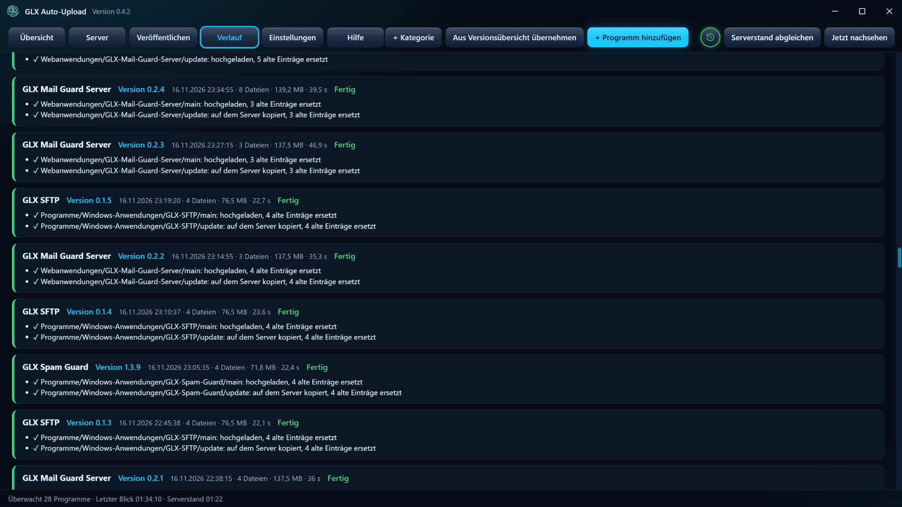
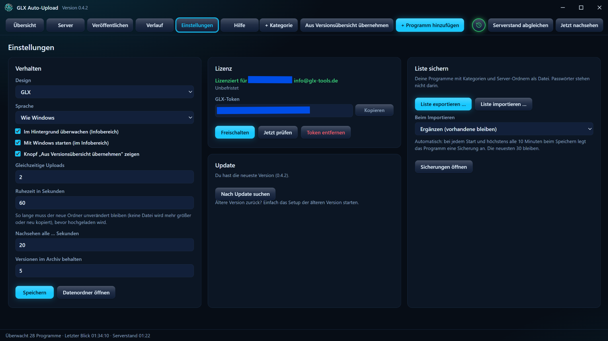
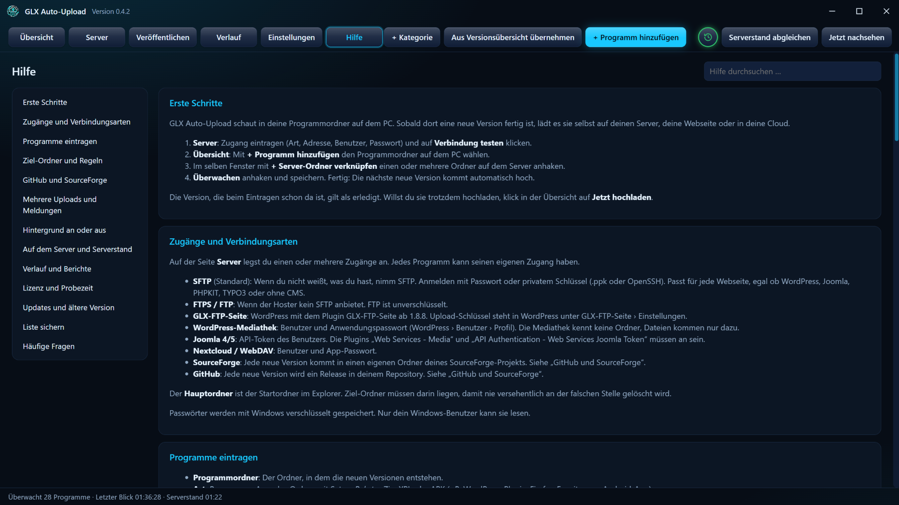

🌍 Sprachen: [🇺🇸 English](README.md) | [🇩🇪 Deutsch](README.de.md)

# 💠 GLX Auto-Upload

### Nie wieder Dateien von Hand hochladen.

*GLX Auto-Upload überwacht die Ausgabeordner auf deinem PC und bringt jede neue Version deiner Programme, Plugins und Apps auf deinen Server und zu GitHub.* ⚡

   

---

## ⬇️ Download

👉 Neueste Version: [Releases](../../releases/latest)  
👉 Shop und Lizenzen: [glx-tools.de](https://glx-tools.de/product/glx-auto-upload/)

---

## 📖 Über GLX Auto-Upload

### Nie wieder Dateien von Hand hochladen

Du baust ein neues Setup, ein neues Plugin oder eine neue App, und GLX Auto-Upload erledigt den Rest. Das Programm sitzt unten rechts im Infobereich, schaut in deine Programmordner auf dem PC und merkt, sobald dort eine neue Version fertig ist. Dann lädt es sie in die Ordner auf deinem Server, die du dafür festgelegt hast. Danach bekommst du einen kurzen Bericht, was wohin gegangen ist.

### Für Programme, Plugins und Apps

Windows-Programme mit Ausgabe-Ordner und Setup (EXE oder MSI).

Auch Begleitdateien wie version.json, Was-ist-neu und PAD-Dateien (XML) für Download-Portale gehen mit, auf Wunsch je Ordner gefiltert.

Pakete wie Zip, XPI oder APK: WordPress-Plugins, Firefox-Erweiterungen, Nextcloud-Apps, Android-Apps, Webanwendungen.

Die Versionsnummer findet GLX Auto-Upload selbst: im Ordnernamen, in der version.json, in der EXE, im Dateinamen oder im Inhalt der Zip. Unter „Was gerade lokal da ist“ siehst du sofort, welche Version erkannt wird.

### Lädt nur, was wirklich fertig ist

Ein Setup zählt erst, wenn es vollständig geschrieben ist. Hochgeladen wird erst, wenn sich im Ordner eine Weile nichts mehr ändert. Halbe Dateien kommen nie auf den Server.

Ordner wie „_zu_loeschen“, „Papierkorb“ oder „backup“ werden nie als neue Version genommen.

Kurz vor dem Hochladen wird der Ordner noch einmal geprüft. Hat sich etwas geändert, wartet das Programm.

Liegt auf dem Server schon dieselbe oder eine neuere Version, wird nichts hochgeladen.

Auf Wunsch fragt es vorher nach: Hochladen, Später oder Überspringen.

### Alle gängigen Wege auf deinen Server

SFTP mit Passwort oder Schlüssel (.ppk oder OpenSSH). Passt für jede Webseite, egal ob WordPress, Joomla, TYPO3, PHPKIT oder ganz ohne CMS.

FTPS und FTP, wenn dein Hoster kein SFTP anbietet. Das Zertifikat des Servers wird gemerkt, meldet sich später ein anderes, warnt das Programm.

GLX-FTP-Seite: direkt in die Download-Ordner deiner WordPress-Seite, nur mit einem Upload-Schlüssel, ganz ohne FTP-Zugang. Prüfsumme und Versionsnummer werden dabei gleich mit eingetragen.

WordPress-Mediathek mit Anwendungspasswort.

Joomla 4 und 5 mit API-Token.

Nextcloud und WebDAV mit App-Passwort.

Du kannst mehrere Zugänge anlegen. Jedes Programm darf seinen eigenen haben.

### Neue Version gleich auf GitHub

Jede neue Version kann zusätzlich als Release erscheinen, dort, wo viele Leute nach Software suchen. Dafür gibt es oben eine eigene Seite „Veröffentlichen“ mit einem aufklappbaren Bereich je Anbieter. Deine Server-Ordner und Kategorien bleiben davon unberührt.

GitHub: Für jede Version wird ein Release mit Tag und Titel angelegt, zum Beispiel Tag „2.9.5“ und Titel „Mein Programm v2.9.5“. Der Text kommt aus deiner Whats-new- bzw. Was-ist-neu-Datei, dazu die EXE und die Textdateien.

Ordnername, Tag und Titel stellst du mit Platzhaltern wie {version} und {programm} ein und siehst sofort ein Beispiel. Welche Dateien ins Release kommen (zum Beispiel EXE und Textdateien), wählst du mit einem Klick.

### Ein Upload, viele Ziel-Ordner

Jede neue Version kann in mehrere Ordner gleichzeitig gehen, zum Beispiel Download und Update.

Inhalt ersetzen: Erst wird alles hochgeladen und geprüft, dann kommt der alte Inhalt weg. Fehlt das Setup, wird nichts gelöscht.

Nur dazulegen: Neue Dateien kommen dazu, vorhandene bleiben unangetastet.

Archiv-Unterordner mit Versionsnummer, die neuesten Versionen bleiben stehen.

Setup-Archiv: Jede Setup-EXE mit Versionsnummer im Namen, es wird nie etwas gelöscht.

Je Ordner wählst du, welche Dateien hineinkommen (zum Beispiel nur EXE oder nur JSON) oder nur einen Unterordner wie „update“.

Mehrere Programme werden gleichzeitig hochgeladen, wie viele, stellst du selbst ein (1 bis 5). Uploads in dieselben Ordner warten aufeinander.

Bei SFTP lädt das Programm nur einmal hoch und lässt den Server die weiteren Ordner selbst kopieren. Das spart bei großen Setups viel Zeit.

### Du siehst immer, was auf dem Server liegt

Die Spalte „Auf dem Server“ zeigt, welche Version wirklich in den Ziel-Ordnern liegt. Das wird beim Start, alle 15 Minuten und auf Knopfdruck nachgesehen.

Alle Meldungen liegen gestapelt in einem einzigen Fenster unten rechts, wie beim Kopieren in Windows: Fortschritt mit Ordner, Datei, Tempo und Restzeit, Rückfragen und Berichte. Ab drei Meldungen klappt der Rest ein. Das Fenster nimmt dir nie den Fokus weg und lässt sich auf eine schmale Fortschrittsleiste einklappen.

Jeder Bericht nennt den Quellordner auf deinem PC und alle Ziele. „Erneut versuchen“ liest den Ordner frisch ein.

Alle Uploads stehen im Verlauf, dazu ein ausführliches Protokoll.

### Sicher eingebaut

Ziel-Ordner müssen im eingetragenen Hauptordner liegen, damit nie versehentlich an der falschen Stelle gelöscht wird.

Passwörter werden mit Windows verschlüsselt gespeichert, nur dein Windows-Benutzer kann sie lesen.

Wird die Anmeldung abgelehnt, versucht das Programm es nicht immer wieder, damit dein Server dich nicht sperrt.

Deine Liste wird bei jedem Start und beim Speichern automatisch gesichert. Exportieren und Importieren geht auch, ohne Passwörter.

### Bequem zu bedienen

Ein runder Knopf oben zeigt, ob das Programm im Hintergrund arbeitet: grüner Ring an, roter Ring aus.

Programme in Kategorien, die du direkt in der Übersicht umbenennen oder löschen kannst. Server-Explorer zum Anklicken der Ziel-Ordner.

12 Designs, Deutsch und Englisch, Hilfe mit Suche direkt im Programm.

Updates mit einem Klick, vorher mit Prüfsumme geprüft. Eine ältere Version bekommst du einfach über ihr Setup zurück, deine Einstellungen bleiben.

### Lizenz

14 Tage kostenlos und voll nutzbar. Danach schaltest du das Programm mit deinem GLX-Token frei (Einstellungen › Lizenz). Deine Liste bleibt in der Probezeit und danach erhalten. Zum Umzug auf einen anderen PC entfernst du den Token und trägst ihn dort ein.

---

## 📸 Überblick & Screenshots

### 1️⃣ Übersicht aller überwachten Programme

### 2️⃣ Server-Zugänge (SFTP, FTP, WordPress, Nextcloud ...)

### 3️⃣ Auf GitHub veröffentlichen

### 4️⃣ Verlauf der Uploads

### 5️⃣ Einstellungen, Lizenz und Update

### 6️⃣ Integrierte Hilfe

---

## ✨ Funktionen

- 🚀 **Findet neue Versionen selbst:** Liest die Version aus Ordnername, version.json, EXE, Dateiname oder dem Inhalt einer ZIP, für Setups, Plugins, Firefox-Add-ons, Nextcloud- und Android-Apps.
- 🧩 **Lädt nur fertige Dateien hoch:** Ein Ordner wird erst hochgeladen, wenn sich eine Weile nichts mehr ändert, und direkt vor dem Upload noch einmal geprüft. Ordner wie Backup oder Papierkorb werden ignoriert.
- ⚙️ **Alle gängigen Servertypen:** SFTP mit Passwort oder Schlüssel (.ppk oder OpenSSH), FTP und FTPS, WordPress-Mediathek, Joomla 4/5, Nextcloud und WebDAV, mit mehreren Zugängen.
- 🔒 **GitHub-Releases:** Jede neue Version kann ein GitHub-Release mit Tag, Titel, Hinweisen und Dateien werden.
- 📂 **Arbeitet mit GLX FTP-Seite:** Lädt mit einem Upload-Schlüssel direkt in die Download-Ordner deiner WordPress-Seite, ganz ohne FTP-Zugang. Prüfsumme und Version werden gleich mit eingetragen.
- ⚡ **Ein Upload, viele Ordner:** Schicke eine Version gleichzeitig in Download- und Update-Ordner, wähle Ersetzen, Nur hinzufügen oder Archivieren und filtere, welche Dateien wohin gehen.
- 🎨 **Parallele Uploads:** Mehrere Programme gleichzeitig hochladen (1 bis 5). Per SFTP werden große Setups nur einmal hochgeladen und auf dem Server kopiert.
- 🌍 **Immer wissen, was online ist:** Die Spalte „Auf dem Server“ zeigt die Version, die wirklich in den Zielordnern liegt, auch bei GitHub, geprüft alle 15 Minuten.
- 🛠️ **Sicher gebaut:** Passwörter werden von Windows verschlüsselt, Zielordner müssen im eingestellten Basisordner liegen, und abgelehnte Anmeldungen werden nicht endlos wiederholt.
- 📊 **Bequem zu bedienen:** Gestapeltes Fortschrittsfenster, das nie den Fokus stiehlt, Upload-Verlauf und Protokoll, automatische Sicherung deiner Liste, 12 Designs, Deutsch und Englisch, Hilfe mit Suche.

---

## 🧩 Systemanforderungen

- Windows 10 oder Windows 11 (64-Bit)
- Microsoft WebView2 (in Windows 11 enthalten)
- Zugang zu deinem Server, deiner Website oder Cloud

---

## 🧪 Testzeitraum & Lizenz

14 Tage kostenlos und voll nutzbar. Danach wird es mit deinem GLX-Token freigeschaltet (Einstellungen > Lizenz). Deine Liste bleibt während und nach der Testzeit erhalten. Lizenz auf [glx-tools.de](https://glx-tools.de).

---

## 🔐 Datenschutz

Passwörter werden mit Windows (DPAPI) verschlüsselt und können nur von deinem Windows-Benutzer gelesen werden. Exporte deiner Liste enthalten nie Passwörter.

---

## 🔗 Mehr zu diesem Produkt

👉 [glx-tools.de](https://glx-tools.de/product/glx-auto-upload/)  
Support: **info@glx-tools.de**

---

## 📄 Lizenz

Copyright © 2026 GLX Tools – Gordon Lehmann. Alle Rechte vorbehalten.  
Dies ist proprietäre kommerzielle Software. Es wird keine Open-Source-Lizenz gewährt. Dieses Repository enthält nur Release-Downloads und Dokumentation; der Quelltext wird nicht veröffentlicht.

---

Mit ❤️ gemacht von **Dreamdancer100**

