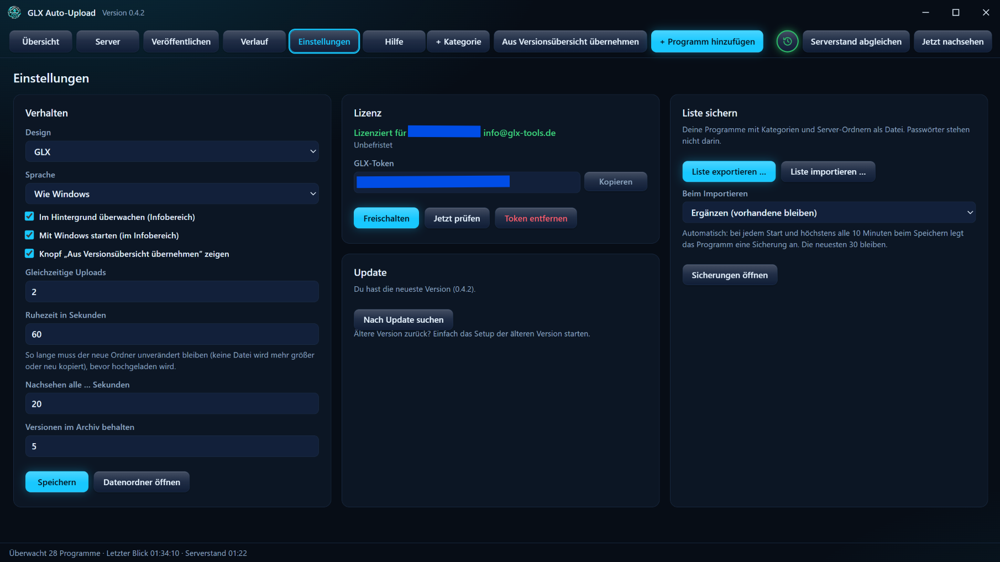
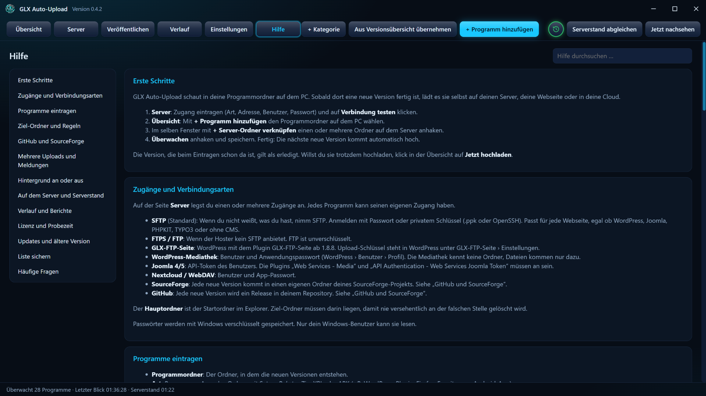

🌍 Languages: [🇺🇸 English](README.md) | [🇩🇪 Deutsch](README.de.md)

# 💠 GLX Auto-Upload

### Never upload files by hand again.

*GLX Auto-Upload watches the output folders on your PC and brings every new version of your programs, plugins and apps to your server, GitHub and SourceForge.* ⚡

   

---

## ⬇️ Download

👉 Latest version: [Releases](../../releases/latest)  
👉 Shop and licences: [glx-tools.de](https://glx-tools.de/product/glx-auto-upload/)

---

## 📸 Overview & Screenshots

### 1️⃣ Overview of all watched programs

### 2️⃣ Server access (SFTP, FTP, WordPress, Nextcloud ...)

### 3️⃣ Publish to GitHub and SourceForge

### 4️⃣ Upload history

### 5️⃣ Settings, licence and update

### 6️⃣ Built-in help

---

## ✨ Features

- 🚀 **Finds new versions by itself:** Reads the version from the folder name, version.json, the EXE, the file name or the content of a zip, for setups, plugins, Firefox add-ons, Nextcloud and Android apps.
- 🧩 **Uploads only finished files:** A folder is uploaded only when nothing has changed for a while and it is checked again just before the upload. Folders like backup or recycle bin are ignored.
- ⚙️ **All common server types:** SFTP with password or key (.ppk or OpenSSH), FTP and FTPS, WordPress media library, Joomla 4/5, Nextcloud and WebDAV, with several accounts.
- 🔒 **GitHub and SourceForge releases:** Every new version can become a GitHub release with tag, title, notes and files, and a SourceForge version folder that becomes the latest download.
- 📂 **Works with GLX FTP-Seite:** Uploads straight into the download folders of your WordPress site with an upload key, no FTP account needed. Checksum and version are filled in too.
- ⚡ **One upload, many folders:** Send a version to download and update folders at once, choose replace, add-only or archive mode and filter which files go where.
- 🎨 **Parallel uploads:** Upload several programs at the same time (1 to 5). With SFTP large setups are uploaded once and copied on the server.
- 🌍 **Always know what is online:** The "On the server" column shows the version that is really in the target folders, including GitHub and SourceForge, checked every 15 minutes.
- 🛠️ **Safe by design:** Passwords are encrypted with Windows, target folders must lie inside the configured base folder, and rejected logins are not retried endlessly.
- 📊 **Comfortable to use:** Stacked progress window that never steals focus, upload history and log, automatic backup of your list, 12 designs, German and English, help with search.

---

## 🧩 Requirements

- Windows 10 or Windows 11 (64-bit)
- Microsoft WebView2 (included in Windows 11)
- Access to your server, website or cloud

---

## 🧪 Trial & License

Free and fully usable for 14 days. After that you unlock it with your GLX token (Settings > Licence). Your list is kept during and after the trial. Licence at [glx-tools.de](https://glx-tools.de).

---

## 🔐 Privacy

Passwords are stored encrypted with Windows (DPAPI) and can only be read by your Windows user. Exports of your list never contain passwords.

---

## 🔗 More about this product

👉 [glx-tools.de](https://glx-tools.de/product/glx-auto-upload/)  
For support: **info@glx-tools.de**

---

## 📄 License

Copyright © 2026 GLX Tools – Gordon Lehmann. All rights reserved.  
This is proprietary commercial software. No open-source license is granted. This repository contains release downloads and documentation only; the source code is not published.

---

Made with ❤️ by **Dreamdancer100**

