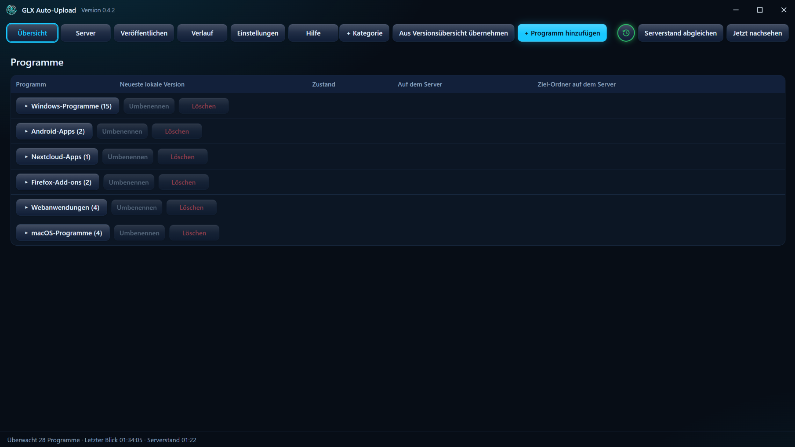
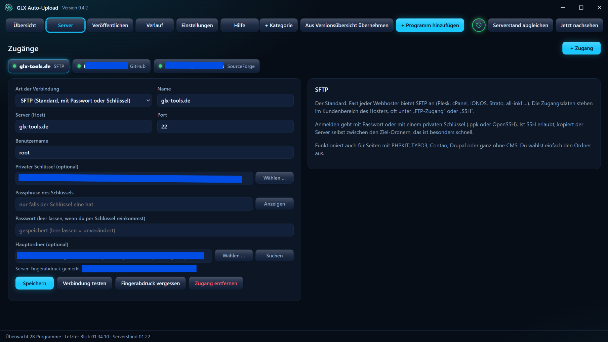
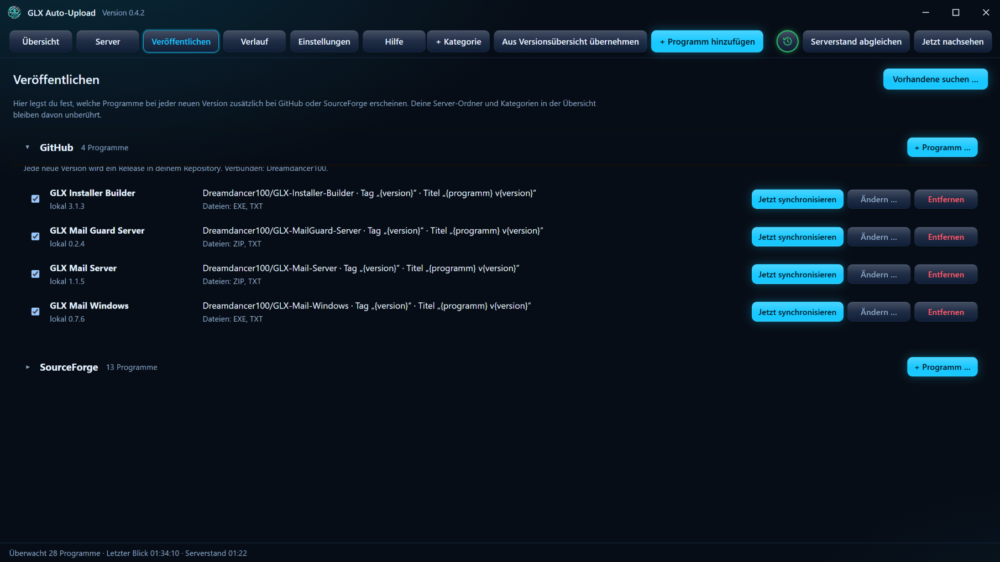
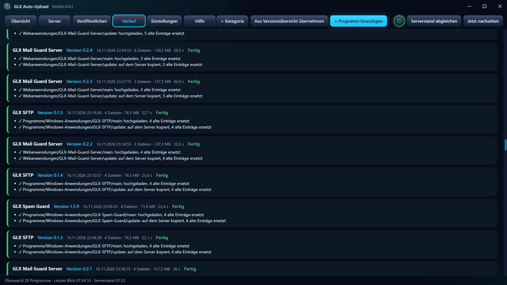

🌍 Languages: [🇺🇸 English](README.md) | [🇩🇪 Deutsch](README.de.md)

# 💠 GLX Auto-Upload

### Never upload files by hand again.

*GLX Auto-Upload watches the output folders on your PC and brings every new version of your programs, plugins and apps to your server and to GitHub.* ⚡

   

---

## ⬇️ Download

👉 Latest version: [Releases](../../releases/latest)  
👉 Shop and licences: [glx-tools.de](https://glx-tools.de/product/glx-auto-upload/)

---

## 📖 About GLX Auto-Upload

### Never upload files by hand again

You build a new setup, plugin or app, and GLX Auto-Upload does the rest. The program sits in the notification area, watches your program folders on the PC and notices as soon as a new version is ready. Then it uploads it to the folders on your server that you have chosen. Afterwards you get a short report of what went where.

### For programs, plugins and apps

Windows programs with an output folder and setup (EXE or MSI).

Companion files such as version.json, What's new and PAD files (XML) for download portals go along too, filtered per folder if you like.

Packages such as Zip, XPI or APK: WordPress plugins, Firefox extensions, Nextcloud apps, Android apps, web applications.

GLX Auto-Upload finds the version number by itself: in the folder name, in version.json, in the EXE, in the file name or inside the Zip. Under "What is available locally" you see right away which version was detected.

### Uploads only what is really finished

A setup only counts once it has been completely written. Uploading starts only when nothing has changed in the folder for a while. Half-written files never reach the server.

Folders such as "_zu_loeschen", "Papierkorb" or "backup" are never taken as a new version.

Just before uploading the folder is checked once more. If something has changed, the program waits.

If the same or a newer version is already on the server, nothing is uploaded.

If you like, it asks first: Upload, Later or Skip.

### Every common way to your server

SFTP with password or key (.ppk or OpenSSH). Works for any website, whether WordPress, Joomla, TYPO3, PHPKIT or without any CMS.

FTPS and FTP if your host does not offer SFTP. The server certificate is remembered, and if a different one shows up later, the program warns you.

GLX-FTP-Seite: straight into the download folders of your WordPress site with just an upload key, no FTP access needed. Checksum and version number are entered at the same time.

WordPress media library with an application password.

Joomla 4 and 5 with an API token.

Nextcloud and WebDAV with an app password.

You can create several connections, and every program may have its own.

### New version straight to GitHub

Every new version can also appear as a release where many people look for software. There is a separate "Publish" page with an expandable section per provider. Your server folders and categories stay untouched.

GitHub: a release with tag and title is created for every version, for example tag "2.9.5" and title "My Program v2.9.5". The text comes from your Whats-new or Was-ist-neu file, plus the EXE and the text files.

Connecting is easy: paste a token, the button to create one is right there.

Folder name, tag and title are set with placeholders such as {version} and {programm}, and you see an example right away. Which files go into the release (for example EXE and text files) is chosen with one click.

"Sync now" sends the current version to GitHub right away without delivering to your own server again.

The "On the server" column also shows which version was last released on GitHub.

### One upload, many target folders

Every new version can go to several folders at once, for example download and update.

Replace content: everything is uploaded and checked first, then the old content is removed. If the setup is missing, nothing is deleted.

Add only: new files are added, existing ones stay untouched.

Archive subfolders with version number, the newest versions are kept.

Setup archive: every setup EXE with the version number in its name, nothing is ever deleted.

Per folder you choose which files go in (for example only EXE or only JSON) or only a subfolder such as "update".

Several programs are uploaded at the same time, you set how many (1 to 5). Uploads into the same folders wait for each other.

With SFTP the program uploads only once and lets the server copy the other folders itself. That saves a lot of time with large setups.

### You always see what is on the server

The "On the server" column shows which version really is in the target folders. It is checked at start, every 15 minutes and at the push of a button.

All messages are stacked in a single window at the bottom right, like copying in Windows: progress with folder, file, speed and remaining time, questions and reports. From three messages on, the rest folds away. The window never steals your focus and can be collapsed into a slim progress bar.

Every report names the source folder on your PC and all targets. "Try again" reads the folder afresh.

All uploads are listed in the history, plus a detailed log.

### Safety built in

Target folders must lie inside the registered main folder, so nothing is ever deleted in the wrong place by mistake.

Passwords are stored encrypted by Windows, only your Windows user can read them.

If the login is rejected, the program does not keep trying, so your server does not lock you out.

Your list is backed up automatically at every start and when saving. Export and import work too, without passwords.

### Easy to use

A round button at the top shows whether the program is working in the background: green ring on, red ring off.

Programs in categories that you can rename or delete right in the overview. A server explorer to click the target folders.

12 designs, German and English, help with search right in the program.

Updates with one click, checked with a checksum first. You get an older version back simply via its setup, and your settings are kept.

### Licence

Free and fully usable for 14 days. After that you activate the program with your GLX token (Settings › Licence). Your list is kept during the trial and afterwards. To move to another PC, remove the token and enter it there.

---

## 📸 Overview & Screenshots

### 1️⃣ Overview of all watched programs

### 2️⃣ Server access (SFTP, FTP, WordPress, Nextcloud ...)

### 3️⃣ Publish to GitHub

### 4️⃣ Upload history

### 5️⃣ Settings, licence and update

### 6️⃣ Built-in help

---

## ✨ Features

- 🚀 **Finds new versions by itself:** Reads the version from the folder name, version.json, the EXE, the file name or the content of a zip, for setups, plugins, Firefox add-ons, Nextcloud and Android apps.
- 🧩 **Uploads only finished files:** A folder is uploaded only when nothing has changed for a while and it is checked again just before the upload. Folders like backup or recycle bin are ignored.
- ⚙️ **All common server types:** SFTP with password or key (.ppk or OpenSSH), FTP and FTPS, WordPress media library, Joomla 4/5, Nextcloud and WebDAV, with several accounts.
- 🔒 **GitHub releases:** Every new version can become a GitHub release with tag, title, notes and files.
- 📂 **Works with GLX FTP-Seite:** Uploads straight into the download folders of your WordPress site with an upload key, no FTP account needed. Checksum and version are filled in too.
- ⚡ **One upload, many folders:** Send a version to download and update folders at once, choose replace, add-only or archive mode and filter which files go where.
- 🎨 **Parallel uploads:** Upload several programs at the same time (1 to 5). With SFTP large setups are uploaded once and copied on the server.
- 🌍 **Always know what is online:** The "On the server" column shows the version that is really in the target folders, including GitHub, checked every 15 minutes.
- 🛠️ **Safe by design:** Passwords are encrypted with Windows, target folders must lie inside the configured base folder, and rejected logins are not retried endlessly.
- 📊 **Comfortable to use:** Stacked progress window that never steals focus, upload history and log, automatic backup of your list, 12 designs, German and English, help with search.

---

## 🧩 Requirements

- Windows 10 or Windows 11 (64-bit)
- Microsoft WebView2 (included in Windows 11)
- Access to your server, website or cloud

---

## 🧪 Trial & License

Free and fully usable for 14 days. After that you unlock it with your GLX token (Settings > Licence). Your list is kept during and after the trial. Licence at [glx-tools.de](https://glx-tools.de).

---

## 🔐 Privacy

Passwords are stored encrypted with Windows (DPAPI) and can only be read by your Windows user. Exports of your list never contain passwords.

---

## 🔗 More about this product

👉 [glx-tools.de](https://glx-tools.de/product/glx-auto-upload/)  
For support: **info@glx-tools.de**

---

## 📄 License

Copyright © 2026 GLX Tools – Gordon Lehmann. All rights reserved.  
This is proprietary commercial software. No open-source license is granted. This repository contains release downloads and documentation only; the source code is not published.

---

Made with ❤️ by **Dreamdancer100**

